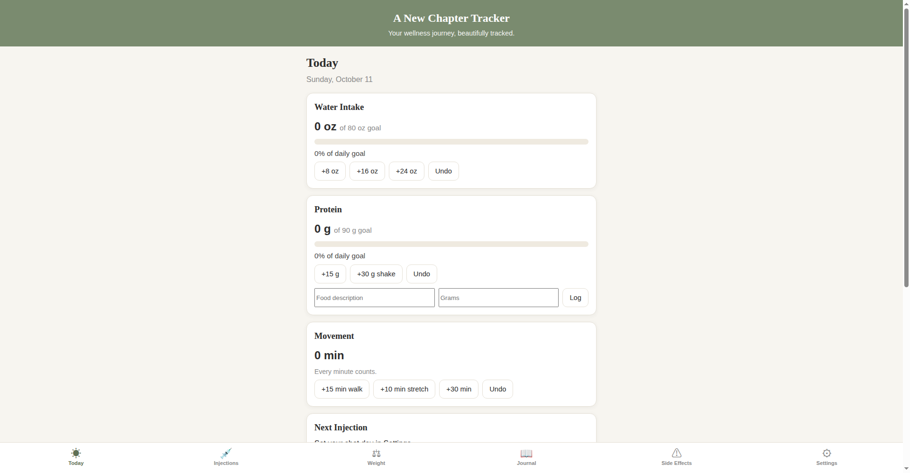

# A New Chapter Tracker

Your GLP-1 wellness journey, beautifully tracked. A private, installable web app designed for people on Zepbound, Wegovy, Ozempic, Mounjaro, and other GLP-1 medications.

**Live app:** https://millrjess.github.io/tracker-app/
**Sales page:** https://millrjess.github.io/tracker/

## Features

- **Today dashboard**: Water intake, protein, and movement at a glance with daily goals and one-tap logging
- **Injection tracking**: Log shots with medication, dose, site rotation, and notes; shot-day countdown with last-site reminder
- **Weight tracking**: Weigh-ins with progress chart and total lost
- **Body measurements**: Waist, hips, chest, arm, thigh, and neck in inches
- **Progress photos**: Monthly photo timeline, stored privately on your device
- **Daily journal**: Mood, star rating, and notes
- **Side effect logging**: Symptom, severity, and what helped
- **Refill reminders**: Prescription refill countdown
- **Data export**: Download everything as a tab-delimited file for Excel or Google Sheets
- **Adjustable goals**: Water and protein targets in Settings

## Privacy

All tracked data stays on your device in localStorage. Nothing is sent to a server, sold, or shared. Anonymous usage statistics (screen views) are collected via Google Analytics to improve the app. There are no accounts and no cross-device sync.

## Tech

Pure HTML, CSS, and JavaScript. No frameworks, no build step. Installable as a PWA on iPhone and Android with offline support via service worker.

## Pricing

$3.99/month or $29.99/year via Stripe.

## Medical disclaimer

This app is for personal tracking only. It does not provide medical advice, diagnosis, or treatment. Always consult your healthcare provider about your medication, dosing, and health decisions.

## Copyright

© 2026 Jessica A. Miller. All rights reserved.
